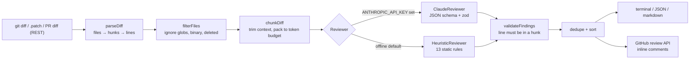

# diffwise

diffwise is a TypeScript code-review tool for `git diff` output. It parses unified diffs into files, hunks and lines, tracking the new-file line number of every line. It drops noise (lockfiles, minified bundles, vendored code), packs the remaining hunks into review units that fit a token budget, and sends each unit to a review provider: Claude (`claude-opus-5-5`, structured JSON output validated with zod) or an offline rule engine with 13 static checks. Every finding must point at a line that is actually in the diff, or it is dropped, so a model's guesses about line numbers never become PR comments. Results go to the terminal, to JSON or markdown, or to inline pull-request review comments through a bundled GitHub Action.

The interesting parts are on the diff-handling side. The parser handles renames, copies, binary files, quoted and octal-escaped paths, `\ No newline at end of file`, and plain `diff -u` output, and it checks every hunk's line count against its header. The chunker trims context and splits oversized hunks into sub-hunks whose headers are still consistent. The heuristic reviewer has a held-out evaluation set that it was not tuned on.

## Features

- **Unified diff parser**: files, hunks and lines with old and new line numbers. Handles added, deleted, renamed and copied files, mode changes, binary files (`Binary files ... differ` and `GIT binary patch`), `\ No newline at end of file`, CRLF input, and quoted paths with spaces or UTF-8. It raises `DiffParseError` with the input line number when a hunk is truncated or malformed.
- **Token-budget chunker**: estimates tokens at 3.5 characters per token, trims hunks to N context lines (default 3), keeps hunks whole when they fit and packs them greedily. A hunk larger than the budget is split at line boundaries, and the new sub-hunk headers re-parse correctly.
- **Noise filter**: glob patterns (`**`, `*`, `?`, `{a,b}`) for lockfiles, `*.min.js`, source maps, snapshots, generated protobuf files, and `dist/`, `build/`, `vendor/` and `node_modules/`. You can add your own globs or turn the defaults off. Binary files, deleted files and files with no added lines are skipped, and each skip is reported with its reason.
- **One `Reviewer` interface, two providers**:
  - `ClaudeReviewer` uses `@anthropic-ai/sdk` with model `claude-opus-5-5`, `output_config.format` (JSON schema) and `effort: "medium"`. It validates the output with zod, checks `stop_reason` (a refusal or `max_tokens` is an error), uses the server-side refusal fallback, and maps SDK errors from most to least specific.
  - `HeuristicReviewer` is offline and deterministic. Its 13 rules are `aws-access-key`, `private-key`, `hardcoded-secret` (GitHub, Slack, Stripe, Anthropic and Google token formats, plus credential-named assignments), `sql-concat`, `eval-usage`, `debugger-statement`, `focused-test`, `empty-catch`, `skipped-test`, `debug-output`, `todo-comment`, `long-function` and `long-line`. The rules read code through a quote-aware scanner, so patterns inside strings or comments do not trigger code rules.
  - Claude is used automatically when `ANTHROPIC_API_KEY` is set. Otherwise the heuristic reviewer runs.
- **Line validation**: a finding is kept only if its `(file, line)` is an added or context line in the diff. Everything else is counted as dropped.
- **Outputs**: a coloured terminal report, JSON, and GitHub-flavoured markdown. `--fail-on <severity>` sets the exit code for CI gates.
- **GitHub Action** (`action.yml`, `node24`): fetches the PR diff and posts one review through the REST API using `fetch` and `GITHUB_TOKEN`, with one RIGHT-side inline comment per finding (up to 50). If GitHub rejects the inline positions (422), it falls back to a review with the summary only. It also writes the markdown summary to `GITHUB_STEP_SUMMARY`.

## Architecture



- **The new-file line number is the anchor for everything.** The parser records it for every added and context line, the chunker renders it next to each line (`  42 + code`) so the model can cite it, and `validateFindings` uses the same index to reject findings outside the diff. GitHub's `line`/`side: RIGHT` review API uses the same coordinates, so no extra mapping is needed.
- **The parser checks hunk line counts against their headers** and does not guess. A diff that has been hand-edited or cut off fails loudly with a line number instead of silently shifting every line number after it.
- **Each provider sets its own unit size.** `Reviewer.maxUnitTokens` is 6,000 for Claude. The heuristic reviewer uses an infinite budget, so whole hunks stay together and rules like `long-function` see entire functions.
- **The LLM client is injected** through a minimal `MessagesClient` interface, so tests check the exact request body (model, effort, schema, fallback header, and no sampling parameters) without touching the network.
- **The Action is bundled with esbuild** into `dist/index.js`, because JavaScript actions run without `npm install`. CI rebuilds the bundle and fails if it differs from the committed copy.

## Quickstart

Requires Node 24.

```bash
npm install
npm run build

# Review the current branch against main (runs `git diff main...HEAD`)
node build/cli.js review --base main

# Review a patch file, or stdin with "-"
node build/cli.js review --diff bench/fixtures/dev/d15-sql-concat-js.patch
git diff | node build/cli.js review --diff - --format markdown

# Options: --format terminal|json|markdown, --provider auto|claude|heuristic,
#          --ignore <glob> (repeatable), --no-default-ignore, --max-tokens N, --context N, --fail-on <severity>
```

Once installed as a package, the binary is `diffwise` (`npx diffwise review --base main`). Copy `.env.example` to set `ANTHROPIC_API_KEY` if you want the Claude provider.

This is real output from the offline reviewer, without an API key:

```text
$ node build/cli.js review --diff bench/fixtures/dev/d15-sql-concat-js.patch
src/repo/users.ts
      6  major    SQL query built from interpolated values; risk of SQL injection. [sql-concat]
         -> Use parameterized queries / bound parameters instead of building SQL strings.
     10  major    SQL query built from interpolated values; risk of SQL injection. [sql-concat]
         -> Use parameterized queries / bound parameters instead of building SQL strings.

2 finding(s) (2 major) in 1 file(s) via heuristic

$ node build/cli.js review --diff bench/fixtures/dev/d20-lockfile-and-minified.patch
skipped: package-lock.json (ignored by **/package-lock.json), public/vendor.min.js (ignored by **/*.min.js), vendor/lib/util.js (ignored by **/vendor/**)

0 finding(s) (no findings) in 0 file(s) via heuristic
```

### GitHub Action

```yaml
on: pull_request
permissions:
  contents: read
  pull-requests: write
jobs:
  review:
    runs-on: ubuntu-latest
    steps:
      - uses: <owner>/diffwise@<ref>
        with:
          anthropic-api-key: ${{ secrets.ANTHROPIC_API_KEY }} # optional; omit for the offline reviewer
          fail-on: critical                                   # optional
```

## Results

> **These are offline-baseline numbers for the heuristic reviewer only.** The Claude provider has not been benchmarked: no API calls were made to produce anything in this README.

- **Command:** `npm run bench` (the full output is in [`bench/RESULTS.md`](bench/RESULTS.md))
- **Data:** 35 synthetic diffs in `bench/fixtures/`, 8 of them clean, with 62 labelled findings.
- **Machine:** 12th Gen Intel Core i7-12700 (16 logical cores), Windows 11 (10.0.26300), Node v24.14.0.
- **Measured:** 2026-11-06.

Matching is exact on (file, new-file line, rule id).

| Split | Fixtures | Labelled findings | TP | FP | FN | Precision | Recall |
| --- | ---: | ---: | ---: | ---: | ---: | ---: | ---: |
| Dev (used while writing rules) | 25 | 32 | 32 | 0 | 0 | 100.0% | 100.0% |
| Held-out (never used for tuning) | 10 | 30 | 30 | 0 | 0 | 100.0% | 100.0% |

Per-rule tables are in `bench/RESULTS.md`. On the held-out split, every one of the 13 rules has between 1 and 4 true positives and no false positives.

**How the held-out split was made.** The held-out fixtures were written by a separate agent session. It was given only the rule definitions (one sentence per rule) and the label format, and was told not to read the rule code or the dev fixtures. It produced each patch with real `git diff` in a throwaway repository, and it included deliberate traps: patterns only in removed lines, `console.error` used for real error handling, secrets read from the environment, placeholder secrets, TODO inside a string, parameterized SQL, `ast.literal_eval`, and Markdown files with long lines. The rules were frozen before the held-out split was first scored, and they have not been changed since. While writing the rules, only `npm run bench -- --dev-only` was run.

**Read the 100% numbers with care.** The corpus is small and synthetic. Both splits were labelled from the same rule definitions the rules implement, so they measure whether the rules match their own specification, not how useful they are on real-world code. See Limitations.

Parser and chunker throughput was measured on a generated diff (`bench/generate.ts`, seed 42) with 2,000 files, 528,050 lines and 25.67 MB, giving 1,488 review units at a 6,000-token budget:

| Stage | Time | Lines/sec | MB/s |
| --- | ---: | ---: | ---: |
| parse (median of 7) | 79 ms | 6,723,831 | 326.9 |
| parse + filter + chunk (median of 7) | 159 ms | 3,325,775 | 161.7 |
| full heuristic review (single run) | 640 ms | 825,504 | 40.1 |

## Tests / CI

```bash
npm run typecheck   # tsc --noEmit, strict mode with noUncheckedIndexedAccess
npm test            # vitest: 90 tests in 7 files
npm run bench       # regenerates bench/RESULTS.md
```

The tests cover the following, and none of them call the network:

- **Parser edge cases:** renames, binary files, no-EOL markers, quoted and octal paths, `diff -u` output, CRLF, and truncated hunks.
- **Chunking:** the token budget, splitting oversized hunks, and re-parsing every generated sub-hunk header.
- **Rules:** positive and negative cases for every rule.
- **The Claude request shape and response handling:** refusal, `max_tokens`, non-JSON and schema-invalid output, SDK error mapping, and dropping hallucinated lines. The SDK client is a fake.
- **Report formats.**
- **The GitHub client:** `fetch` is mocked, including the 422 fallback.
- **The Action entry point end to end:** run against a stubbed `fetch` and environment.

`.github/workflows/ci.yml` runs typecheck, tests, build, a check that the Action bundle is up to date, and the benchmark on Node 24. On pull requests, a second job runs the Action against the repository itself with the heuristic provider.

## Limitations and next steps

- **The heuristic rules are regex and scanner based, not parsers.** Multi-line strings and block comments are only partly tracked. `long-function` uses brace or indentation matching and only flags functions that are entirely new in one hunk. Language-specific rules mainly target JS/TS and Python, with partial Go and Java support (`empty-catch`, `long-function`).
- **The benchmark is small and synthetic.** It has 35 diffs. Its labels follow the same definitions as the rules, and there is no real-world PR corpus. The next step is to label real open-source PRs and to measure the Claude provider against the same labels, with a cost and latency report.
- **Token estimates are approximate.** They use 3.5 characters per token and do not call `count_tokens`, so budgets are approximate.
- **The Claude provider is untested against the live API.** It is tested only with a fake client, and its output quality has not been measured. It reviews up to 4 units concurrently and has no retry or backoff beyond the SDK defaults.
- **The GitHub integration is basic.** It posts one review per run and does not update or resolve earlier diffwise comments. Comments are capped at 50 per review.

## License

MIT, copyright 2026 Bryant Le.
